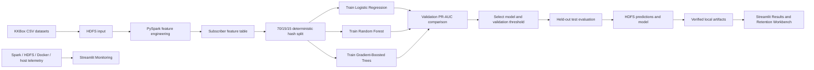

# Customer Churn Prediction & Retention Analytics
## Full Project Report

**Domain:** Distributed data engineering, machine learning and retention analytics  
**Dataset:** KKBox WSDM 2018 Churn Prediction Challenge  
**Stack:** Apache Spark 4.1.4, PySpark, Spark MLlib, Hadoop HDFS, Docker Compose, Streamlit, Pandas and Plotly

## 1. Executive summary

This project implements a distributed subscription-churn prediction pipeline for the KKBox music-streaming subscription dataset. It ingests subscriber labels, subscription transaction history and member attributes into HDFS, builds subscriber-level features with PySpark, trains and compares three Spark MLlib classifiers, selects a model and decision threshold using validation data, evaluates the selected model on a held-out test set, and exposes predictions through an interactive Streamlit retention workbench.

The project also includes operational controls and infrastructure observability. Training runs in a background thread, can be stopped from the dashboard, and reports RUNNING, COMPLETED, FAILED or CANCELLED lifecycle states. The Results tab preserves the latest verified successful result even if a later attempt is stopped or fails. The separate Monitoring tab displays live Spark, HDFS, Docker, master-host and worker-host telemetry.

## 2. Problem statement and objectives

Subscription businesses need to identify subscribers who are likely to churn so retention teams can prioritize outreach and incentives. The project addresses the prediction and operational workflow rather than claiming that a model score alone prevents churn.

Objectives:
- Build a repeatable distributed ETL and machine-learning workflow.
- Use HDFS as the shared distributed storage layer.
- Perform feature engineering and model training with PySpark and Spark MLlib.
- Compare multiple classifiers under a consistent validation protocol.
- Select the decision threshold without tuning on the final test set.
- Produce subscriber-level churn probabilities and risk bands.
- Provide a dashboard for model evaluation, retention-list filtering and cluster monitoring.
- Support physical workers, local Docker-only development and a hybrid topology combining Docker workers on the physical Windows master with workers on separate physical PCs.
- Preserve verified successful results when an individual training attempt is cancelled or fails.

## 3. System architecture

### 3.1 Logical data and execution flow

### 3.2 Infrastructure components

| Component | Responsibility |
|---|---|
| HDFS NameNode | HDFS namespace, metadata and block-location management |
| HDFS DataNode | Stores distributed input and output blocks |
| Spark Standalone master | Coordinates worker registration and application scheduling |
| Spark workers | Execute distributed Spark tasks and ML workloads |
| Spark driver | Orchestrates feature engineering, model training and evaluation |
| Docker Compose | Runs the master-side HDFS and Spark services |
| Worker telemetry agent | Exposes real host CPU, memory, disk and network metrics over HTTP |
| Streamlit | Training controls, Results, retention analysis and Monitoring |

The standard master-side Compose stack contains the NameNode, DataNode and Spark master. The Windows master can also run one or more Docker bridge Spark Workers. In Hybrid (local Docker + physical) mode, those local Docker workers run alongside native Spark Workers on separate physical PCs. The dashboard validates the expected local Docker container IPs and selected physical worker IPs before submitting training. The physical workers must be reachable over the LAN; Docker bridge workers are intentionally local to the master PC.

## 4. Dataset and data scope

The project uses the official KKBox WSDM 2018 churn challenge files:

| File | Purpose |
|---|---|
| train.csv | Subscriber identifiers and official is_churn target |
| transactions.csv | Payment, subscription plan, renewal and cancellation history |
| members_v3.csv | Registration, demographic and member attributes |

The three required CSV files are stored in data/raw/kkbox/ before upload to HDFS under /kkbox/input/.

**Feature cutoff:** 2017-02-28. Transaction records after this cutoff are excluded from feature construction.

The current implementation does not aggregate the large listening activity logs (user_logs.csv and user_logs_v2.csv). This is an explicit scope limitation.

## 5. Data engineering and feature engineering

PySpark reads the source datasets from HDFS, applies the feature cutoff and constructs one feature row per subscriber. The engineered variables represent subscription activity, payment behaviour, renewal/cancellation behaviour, recency and member attributes.

The current feature set contains 20 variables:

| Feature group | Features |
|---|---|
| Transaction volume and value | transaction_count, lifetime_amount_paid, avg_amount_paid, avg_plan_price, avg_plan_days |
| Renewal and cancellation | auto_renew_rate, cancel_rate, last_auto_renew, last_cancel |
| Recency and recent activity | days_since_last_transaction, transactions_last_30d, transactions_last_90d, transactions_last_180d, amount_last_90d |
| Most recent transaction | last_payment_method |
| Member attributes | city, bd, registered_via, gender_code, registration_days |

Recency is the number of days between the feature cutoff and the most recent eligible transaction. Recent activity features summarize transaction counts and amounts over the specified lookback windows. The target is the competition-provided is_churn label. The dataset is imbalanced, so the training pipeline uses class-weighted estimators.

## 6. Train, validation and test methodology

The subscriber population is divided deterministically by subscriber hash:
- Training: 70%
- Validation: 15%
- Test: 15%

This is a deterministic subscriber-level split, not a chronological holdout. The source labels do not provide a reliable per-subscriber event timestamp for a strict temporal evaluation in this implementation. Results should therefore be interpreted as a retrospective benchmark, not as a simulation of future production performance.

The validation set is used to compare models and select the operating threshold. The held-out test set is used for final reporting after model and threshold selection.

## 7. Model development

Three class-weighted Spark MLlib models are trained and compared:

1. **Logistic Regression** — linear baseline classifier.
2. **Random Forest** — bagged tree ensemble that captures nonlinear feature interactions.
3. **Gradient-Boosted Trees** — sequential tree ensemble that focuses later trees on errors from earlier trees.

Validation PR-AUC is the primary model-selection metric because churn is the minority class. ROC-AUC is also reported. The decision threshold is selected using validation F1 and then fixed for held-out test evaluation.

## 8. Reported benchmark results

The metrics below are from the last fully completed and verified training artifact currently present when this report was prepared. A later successful run replaces the preserved successful result snapshot.

### 8.1 Dataset split

| Measure | Value |
|---|---:|
| Training subscribers | 694,513 |
| Validation subscribers | 149,393 |
| Held-out test subscribers | 149,025 |
| Churned labels | 44,653 |
| Retained labels | 649,860 |
| Overall observed churn rate | 6.39% |

### 8.2 Validation model comparison

| Model | Validation PR-AUC | Validation ROC-AUC |
|---|---:|---:|
| Logistic Regression | 0.6601 | 0.9679 |
| Random Forest | 0.8116 | 0.9814 |
| Gradient-Boosted Trees | **0.8346** | **0.9836** |

Gradient-Boosted Trees achieved the highest validation PR-AUC and was selected.

### 8.3 Selected threshold and held-out test metrics

The validation-selected decision threshold was **0.70**.

| Metric | Held-out test result |
|---|---:|
| PR-AUC | **0.8364** |
| ROC-AUC | **0.9854** |
| Precision | 66.71% |
| Recall | 91.37% |
| F1 score | 0.7712 |
| Specificity | 96.96% |
| Balanced accuracy | 0.9416 |
| Accuracy | 96.61% |

Confusion matrix:

| | Predicted retained | Predicted churned |
|---|---:|---:|
| Actually retained | 135,444 (TN) | 4,253 (FP) |
| Actually churned | 805 (FN) | 8,523 (TP) |

The selected threshold prioritizes high churn recall while maintaining useful precision. This identifies most churned subscribers, at the cost of including some retained subscribers in the intervention list. Business teams should consider campaign capacity and intervention costs before choosing a production threshold.

## 9. Dashboard and user workflows

The Streamlit interface intentionally retains two separate tabs.

### 9.1 Results

The Results tab contains:
- Held-out subscriber count and observed churn rate.
- Selected model and test PR-AUC.
- Test ROC-AUC, precision, recall and F1.
- Validation model-comparison chart and table.
- Held-out confusion matrix.
- Subscriber risk-segment distribution.
- Churn-probability histogram.
- Retention action workbench with risk-level and minimum-probability filters.
- Downloadable filtered retention list.
- Expandable evaluation details and limitations.

A cancelled or failed training attempt does not erase the previous verified result. The tab reports the latest attempt's status and continues to display metrics and predictions from the most recent successful run. A new result snapshot is published only after the new model, metrics and predictions pass artifact checks.

### 9.2 Monitoring

The Monitoring tab refreshes its monitoring fragment every five seconds; it does not intentionally refresh the entire dashboard page on that interval. It displays:
- Spark master availability and registered worker state.
- Worker host, Spark UI reachability, cores, allocated memory, executor count and active applications.
- Worker host CPU, RAM, disk and network metrics from the node telemetry agent.
- Master-host CPU, RAM, disk and network metrics.
- Docker container CPU, memory, network and block I/O.
- Spark jobs, tasks, stages, executor activity, shuffle and spill metrics.
- HDFS capacity, DataNode state, missing blocks and under-replicated blocks.
- Training lifecycle state and the training log.

Spark worker core and memory values are Spark allocations, not physical host CPU or RAM usage. Host-level worker metrics are read separately from the agent endpoint.

## 10. Training lifecycle and result integrity

A training attempt moves through one of these states:

| State | Meaning |
|---|---|
| RUNNING | Cluster preparation or training is in progress |
| COMPLETED | Training and required artifact verification succeeded |
| CANCELLED | The user stopped the current training attempt |
| FAILED | The pipeline exited with an error |

Training runs in a background thread so Monitoring can remain responsive. The Stop control requests termination of this project's Spark driver entry point; HDFS and the Spark master remain available.

On a successful run, the application verifies non-empty prediction CSV output, the saved MLlib model and valid metrics. It then stores a copy under artifacts/last_successful/. A later cancelled or failed attempt may leave temporary working artifacts in artifacts/, but it does not replace this verified result snapshot.

## 11. Monitoring agent and security boundary

The standalone src/node_monitor_agent.py exposes GET /health and GET /metrics. It listens on TCP 9108 and reports host-level CPU, memory, disk and cumulative network counters using psutil. Run it on each worker host. The master collects its own OS metrics directly and does not need this agent.

The worker does not need the full project directory or datasets just to expose telemetry; only the agent script and psutil are needed for monitoring. A Spark worker additionally needs a compatible Spark runtime, Java and the configured Python interpreter.

Restrict inbound TCP 9108 to the master LAN IP. Do not expose the telemetry endpoint to untrusted networks.

## 12. Repository layout

| Path | Purpose |
|---|---|
| app.py | Streamlit application, training lifecycle and Results/Monitoring tabs |
| src/train_churn_model.py | PySpark feature engineering, model training, evaluation and prediction |
| src/monitoring.py | Spark, HDFS, Docker, master and worker telemetry collection |
| src/monitoring_ui.py | Monitoring tab and live charts |
| src/node_monitor_agent.py | Standalone worker host metrics endpoint |
| docker/Dockerfile.spark | Project Spark runtime image |
| docker-compose.yml | HDFS and Spark master services plus optional local Docker worker |
| scripts/run_cluster.ps1 | Windows master cluster bootstrap |
| setup_linux_master | Short Linux master setup entry point |
| setup_linux_master.sh | Linux master bootstrap and dashboard launcher |
| setup_linux_worker.sh | Native Linux worker and telemetry bootstrap |
| setup_windows_master_wsl.ps1 | Windows-to-WSL2 Linux master setup |
| setup_windows_worker_wsl.ps1 | Windows-to-WSL2 Linux worker setup |
| setup.md | Full environment and cluster setup guide |
| artifacts/ | Runtime-only outputs, ignored by Git; the dashboard preserves the latest verified successful run locally |

## 13. Limitations and responsible interpretation

- Listening activity logs are not yet included in feature engineering.
- The deterministic hash split is not a chronological validation strategy.
- Competition labels and historical data may not represent a current production population.
- High predictive performance does not establish that a retention offer will causally prevent churn.
- Threshold choice should account for intervention cost, campaign capacity and false-positive/false-negative trade-offs.
- Monitoring time-series points are held in the active Streamlit session and are not a durable time-series database.
- Spark Standalone does not provide strict per-application host affinity. The dashboard's selected-host control is a required-host preflight, not a guarantee that tasks execute only on those hosts.

## 14. Further development

Potential extensions include listening-activity feature aggregation, temporal backtesting, probability calibration, cost-sensitive threshold optimization, drift monitoring, durable telemetry storage, automated worker service management and scheduled model retraining.

---

For installation, network configuration, worker setup and run commands, see **[setup.md](setup.md)**.
